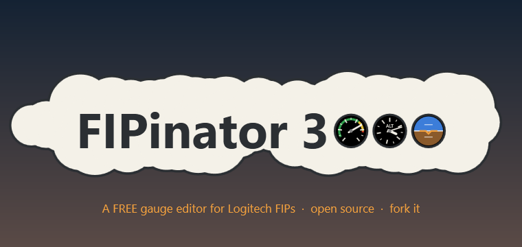
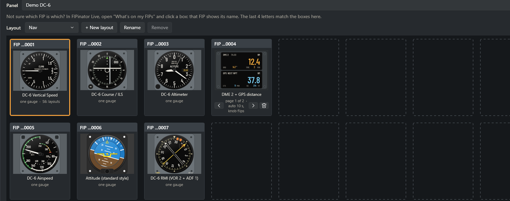
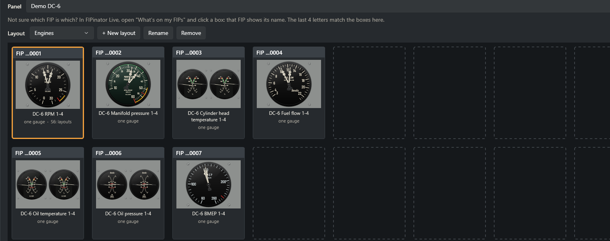
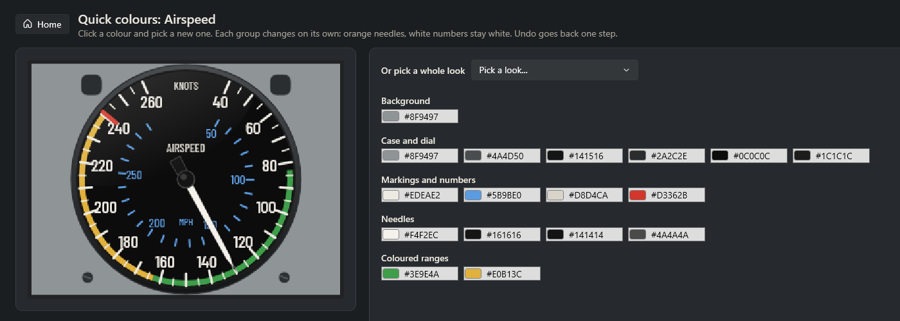
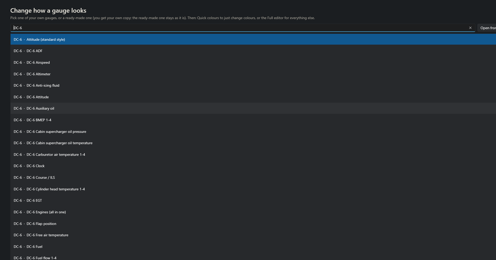
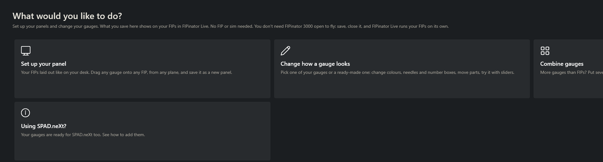

# FIPinator 3000

**FIPinator Live's accessory: set up your FIPs like your desk, switch whole layouts, recolour any gauge, combine
gauges. Free, for Logitech (Saitek) Flight Instrument Panels and MSFS 2024.**

FREE and open source (AGPL-3.0): free to use, change, share and fork. No account, no subscription.

| | |
|---|---|
| **[FIPinator Live](https://github.com/Pribilof-Hangar/fipinator-live)** | The main app: runs your FIPs from the sim. **You need it.** |
| **[FIPinator 3000](https://github.com/Pribilof-Hangar/fipinator-3000)** (you are here) | Live's accessory for making changes. |
| **[FIPinator gauges for SPAD.neXt](https://github.com/Pribilof-Hangar/fipinator-spad-gauges)** | A full-on SPAD.neXt person? The same gauges as SPAD.neXt gauges (a port, less tested). |

**Get it:** the [FIPinator Live installer](https://github.com/Pribilof-Hangar/fipinator-live/releases) installs
FIPinator 3000 too (a tick box, on by default). Or install it on its own from
[this repo's releases](https://github.com/Pribilof-Hangar/fipinator-3000/releases). It needs FIPinator Live to put
its panels and gauges on your FIPs, and it doesn't need to be open while you fly: make your changes, save, close
it, and Live carries on.

---

## What it does

### Set up your panel like your desk

Each box is one of your FIPs. Drag the boxes into the layout you have on your desk (one row, two rows, a column,
any mix), drag a gauge from one FIP onto another to swap them, or drag any gauge from the full list onto a FIP:
any gauge on any FIP, from any plane. Right-click a FIP to replace its gauge, add more gauges to flip through, flip
them with the left knob, or let them flip by themselves. Save it, or **save as a new panel** and keep the original.

### Layouts: a whole second panel on the same FIPs

Make a **Nav** layout and an **Engines** layout (or as many as you like) for the same FIPs, and pick one FIP button
to switch between them: in FIPinator Live, one press flips every FIP to the next layout. Great with only a few FIPs.

### Change how a gauge looks

Pick one of your gauges or any of the ready-made ones (you get your own copy; the original stays as it is):

- **Quick colours**: the gauge's colours sorted into plain groups (background, case and dial, markings, needles,
  coloured ranges). Click one, pick a new colour: orange needles, and the white numbers stay white. Or pick a whole
  look (DC-6 dark, 727 grey-green, Cessna black...).
- **Full editor**: everything else, for when you want to move parts, change needles, number boxes and arcs.

### And more

- **Combine gauges**: more gauges than FIPs? Put several needles on one dial, or two gauges side by side.
- **SPAD.neXt too**: when SPAD.neXt is on your PC, every gauge you save is also saved for SPAD.neXt.
- **Brand-new gauges with AI**: making a gauge from scratch, or from a cockpit screenshot, is best done with an AI
  assistant. 3000 has the [AI README](https://github.com/Pribilof-Hangar/fipinator-live/blob/main/docs/guides/making-gauges-with-ai.md)
  and the [gauge-making guide](https://github.com/Pribilof-Hangar/fipinator-live/blob/main/docs/guides/gauge-making-guide.md)
  one click away (Claude recommended, any AI works).
- **Help built in**: Logs, Copy problem report and Report a problem (a pre-filled GitHub issue you check and submit).

## The story

I made FIPinator for my own PMDG DC-6 in MSFS 2024, and that's mostly what I fly. The DC-6 gauges are the ones I
really know work. I've also flown some with the Boeing 727 and the Saab 340B and fixed what I found. The rest
(classic singles and twins, Cessna 404 Titan, Caravan, 737 MAX, radios, autopilot and more) I made for fun.
**Not every gauge has been tested**: most work, some may need work, and the basic layout of every gauge is already
there, so fixing one is usually a small job. If you know your way around gauges, or have an AI helper, you can
fix them.

FIPinator 3000 is the companion I use to set up and tweak my panels for FIPinator Live: arranging my FIPs like my
desk, layouts, colours. Making brand-new gauges from scratch is the AI part.

I got what I wanted out of this project, so **I have no plans to keep it updated.** If I get bored, or if it
catches on, I might come back with my AI to look at issues and make a few more gauges, but **no promises**. It's
for the world now: use it, mod it, personalise it, fork it, make it better. I like to think there are some great
people out there who can take this to a new level.

## Testers wanted

If something's off, **open an issue** (3000's **Report a problem** button fills most of it in), or fix it in your
fork and share it.

## What it needs

- Windows 11 and **FIPinator Live** (for your FIPs). No FIP and no sim needed to make changes.
- Nothing else: it carries its own .NET.

**Only tested on Windows 11 with MSFS 2024.** It may well work elsewhere, but that hasn't been tested. An AI
assistant can probably help you adapt it; share what you get working.

## Built from scratch, made with AI

FIPinator was written from scratch, with an AI assistant (Claude): its own code, its own gauges, drawn from the real
instruments. It's young, so expect quirks that long-established tools have already ironed out. Report them, or fix
them and share the fix. The gauge drawing, the gauge format and the shared code live in
[FIPinator Live](https://github.com/Pribilof-Hangar/fipinator-live); this repo has 3000's own app and a copy of the
shared code it needs, so it builds on its own.

Not made by, affiliated with or endorsed by Logitech, Microsoft or PMDG.
